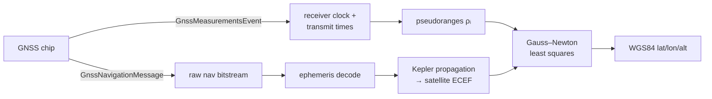

# Raw GNSS Trilateration

An Android app that pulls **raw satellite signals** off the phone's GNSS chip and computes its own position from first principles, no OS positioning of any kind.

Recovers position to within **~500 m** of truth.

The phone is used as a _sensor_ via its GNSS receiver, not a positioning service. It gives us two things: when each satellite signal arrived, and when it was sent. Everything else is derived.

---

## How it works

To compute a position, you need exactly **three things** from each satellite.

**1. When the satellite sent the signal.**
Broadcast by the satellite, timestamped by its onboard atomic clock. Read straight off `receivedSvTimeNanos`.

**2. When your phone received it.**
Comes from the phone's internal clock, corrected onto GPS time: `timeNanos − fullBiasNanos`.

**3. Where the satellite was at that instant.**
Nobody hands you this. It has to be decoded from the satellite's own broadcast and propagated forward. This is the hard part, and most of the code below.

---

Subtract (1) from (2) and you have the signal's **travel time**. Multiply by the speed of light and you have the **distance** to that satellite.

That distance doesn't tell you where you are. It tells you you're somewhere on the surface of a **sphere** — radius = that distance, centred on the satellite.

So draw a sphere around a second satellite, and a third. **Three spheres intersect at a single point, and that point is you.**

### So why does GPS need four?

Because step (2) is a lie. Your phone keeps time with cheap quartz, not an atomic clock, so its clock is off by some unknown bias `δt`. And at the speed of light, being off by **1 microsecond puts you 300 metres away** from where you actually are.

So `δt` is a fourth unknown, sitting alongside `x`, `y`, `z`. Four unknowns need four equations — a fourth satellite. Take the equation of a sphere and add the clock-bias term:

```
ρᵢ = √( (x−xᵢ)² + (y−yᵢ)² + (z−zᵢ)² ) + c·δt
```

Write that once per satellite and solve the system for `(x, y, z, δt)`. The receiver's clock error falls out of the solve for free.

That's the entire idea. Everything below is the machinery to actually get there — and almost all of it is spent on ingredient (3).



---

## The code

### `GNSSLogger/.../MainActivity.java` — capture, decode, propagate

**Three callbacks on `LocationManager`.** `GnssStatus.Callback` lists visible SVIDs; `GnssMeasurementsEvent.Callback` delivers the receiver clock (`timeNanos`, `fullBiasNanos`) and per-satellite `receivedSvTimeNanos`; `GnssNavigationMessage.Callback` delivers the raw broadcast bitstream. That third one is the whole project — it's the satellite telling us its own orbit.

**`extractBits(byte[] data, int startBit, int numBits)`** — the navigation message is a 300-bit frame (10 words × 30 bits) with fields packed at arbitrary bit offsets that don't respect byte boundaries. So this walks the array bit by bit, MSB-first, shifting each bit into an accumulator. Everything downstream depends on it being exactly right.

**`twosComplement(int value, int bits)`** — decoded fields are signed at their _native_ width (8, 14, 16, 22, 24, 32 bits), not at Java's 32. Sign-extending a 14-bit `IDOT` as if it were an `int` silently produces a garbage orbit, so the sign bit is tested at `1 << (bits−1)` and the value wrapped manually.

**`parseGPSNavigationMessage(int svid, byte[] data)`** — reads the subframe ID at bit 49, then unpacks that subframe's fields and applies the power-of-two scale factors from IS-GPS-200:

```java
ephem.e        = extractBits(data, 166, 32)                     * Math.pow(2, -33);
ephem.sqrtA    = extractBits(data, 226, 32)                     * Math.pow(2, -19);
ephem.m0       = twosComplement(extractBits(data, 106, 32), 32) * Math.pow(2, -31) * Math.PI;
ephem.omegaDot = twosComplement(extractBits(data, 240, 24), 24) * Math.pow(2, -43) * Math.PI;
```

The 16 orbital parameters are split across three subframes arriving in sequence, so results accumulate into a per-satellite `GPSEphemeris` object (subframe 1 → clock corrections; 2 → `e`, `√A`, `M₀`, `Δn`, `toe`; 3 → inclination, `Ω₀`, `Ω̇`, `ω`). `isComplete()` gates position computation until all three have landed — up to 30 s after a cold start.

**`calculateSatellitePosition(int svid, double transmitTime)`** — the orbital mechanics, per IS-GPS-200:

- `tk = transmitTime − toe`, wrapped at ±302,400 s for GPS week crossover.
- Mean motion `n = √(μ/A³) + Δn`, then mean anomaly `Mₖ = M₀ + n·tk`.
- **Kepler's equation** `Mₖ = Eₖ − e·sin(Eₖ)` is transcendental — no closed form. Solved by fixed-point iteration, capped at 10 passes, breaking at 1e-12.
- **Perturbations.** The orbit isn't a clean ellipse (Earth's oblateness, third-body pull), so the broadcast carries six harmonic coefficients that correct argument of latitude, radius, and inclination:
  ```java
  double duk = ephem.cus * Math.sin(2*phik) + ephem.cuc * Math.cos(2*phik);
  double drk = ephem.crs * Math.sin(2*phik) + ephem.crc * Math.cos(2*phik);
  double dik = ephem.cis * Math.sin(2*phik) + ephem.cic * Math.cos(2*phik);
  ```
- **Earth rotation.** The planet spins underneath the orbit during the signal's ~70 ms flight, so the ascending node carries `Ω̇ₑ = 7.2921151467e-5 rad/s` in two places:
  ```java
  double Omegak = ephem.omega0 + (ephem.omegaDot - EARTH_ROTATION_RATE) * tk
                                - EARTH_ROTATION_RATE * ephem.toe;
  ```
  Drop this and the fix is hundreds of metres off. It's also why the output is **ECEF** (Earth-fixed) rather than inertial — the receiver we're solving for is bolted to a rotating planet.

**`ecefToLatLonAlt(x, y, z)`** — longitude is a clean `atan2(y, x)`. Latitude isn't: WGS84 is an oblate spheroid, so the geodetic normal misses the centre and latitude/altitude are coupled. Solved by iteration (5 passes converges).

### `compute/calculations.py` — pseudoranges and the solve

**Receiver clock → GPS time.** `timeNanos` alone is meaningless; it has to be mapped into GPS time and reduced mod one week (604,800 s), since `receivedSvTimeNanos` is a time-of-week:

```python
Trx  = ReceiverTimeNanos - FullBiasNanos
Tmod = Trx % (604_800 * 1_000_000_000)
```

**Pseudoranges.** `ρᵢ = c · (Tmod − receivedSvTimeNanosᵢ)`. _Pseudo_ because it still contains the receiver clock bias — we don't remove it, we solve for it.

**Gauss–Newton least squares.** The system is nonlinear (unknowns sit under a square root), so there's no matrix inverse to reach for. Linearise, correct, repeat:

- residual: `fᵢ = ‖sᵢ − x‖ + c·δt − ρᵢ`
- Jacobian row: the unit line-of-sight vector `−(sᵢ − x)/‖sᵢ − x‖`, with `c` in the clock column
- update: `Δ = (JᵀJ)⁻¹ Jᵀ r`, iterating until the correction falls below tolerance

Starting from the Earth's centre it converges in a handful of iterations. With more than four satellites the system is overdetermined and least squares averages the noise down rather than failing — which is exactly why real receivers use every satellite they can see.

---

## It actually runs

Live capture on a OnePlus, 27 satellites visible, PRNs 18/23/29/31 used:

```
Receiver timeNanos=9437220000000  fullBiasNanos=-1449555351719600456
SVID=18  recvSvTimeNanos=455495364139536   →  Δt=15.860 ms  →  ρ=4,754,000 m
SVID=23  recvSvTimeNanos=455495362745780   →  Δt=17.254 ms  →  ρ=5,172,000 m
SVID=29  recvSvTimeNanos=455495373391793   →  Δt= 6.608 ms  →  ρ=1,981,000 m
SVID=31  recvSvTimeNanos=455495352328931   →  Δt=27.671 ms  →  ρ=8,295,000 m
```

Solved fix lands within ~500 m of true position.

---

## Why relativity is not optional here

Everything above keys off `ρ = c·Δt`, so clock error _is_ position error: **1 μs ≈ 300 m**.

GPS satellites orbit at ~20,200 km at ~3.9 km/s. Special relativity slows their clocks by −7 μs/day; general relativity (weaker gravitational potential up there) speeds them up by +45 μs/day. Net: **+38 μs/day**, which is ~11 km of position error accumulating per day if ignored.

It isn't ignored — satellite clocks are pre-adjusted before launch and corrected in the broadcast model, which means the `receivedSvTimeNanos` this project consumes is _already_ relativity-corrected. The correction is baked in before the data ever reaches the phone. GPS doesn't merely benefit from relativity; it doesn't function without it.

---

## Running it

```
GNSSLogger/                          # Android app (Java)
  └── app/src/main/java/com/ashank/gnsslogger/MainActivity.java
compute/
  └── calculations.py                # pseudoranges + least-squares solve
```

1. Open `GNSSLogger/` in Android Studio. Enable Developer Options + USB debugging.
2. Raw GNSS measurements **do not work on an emulator** and are unsupported on some chipsets — check `GnssCapabilities`.
3. Grant `ACCESS_FINE_LOCATION` and run **outdoors**; the navigation message needs a clean signal, and subframes 1–3 take up to 30 s to all arrive.
4. Output streams to the on-screen log and Logcat under tag `GNSS_APP`. Feed it to `python compute/calculations.py`.

## Notes

- **`STATE_CODE_LOCK` matters.** Before code lock, `receivedSvTimeNanos` isn't a real transmit time and the pseudorange is nonsense. Measurements are filtered on it.
- **`fullBiasNanos` is huge and negative** — not a bug. It's the offset from the GPS epoch, and subtracting it is what maps phone time onto GPS time.
- **Broadcast ephemeris beats TLE lookups.** An earlier pass used CelesTrak TLEs + SGP4; it works as a cross-check, but TLEs are stale by design, output ECI (so you still owe a rotation), and require a PRN → NORAD ID mapping that breaks because PRNs get recycled between satellites.

## Stack

Java / Android (`LocationManager`, `GnssMeasurementsEvent`, `GnssNavigationMessage`) · Python / NumPy · GPS IS-GPS-200 broadcast ephemeris · WGS84
